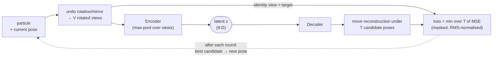

# cryo2dclass

**Unsupervised 2D classification of cryo-EM / cryo-ET particles.**

A rotation-invariant autoencoder learns a low-dimensional embedding of every particle, with an
exhaustive in-plane pose search (rotation, shift, mirror) built into the reconstruction loss. So
the network learns *what* a particle looks like separately from *how it is oriented*.
Particles are then clustered in the embedding space, and the tool writes class averages,
per-particle poses and cluster labels.

- No reference or initial model needed; pure PyTorch, no EM-package dependencies.
- Reads `.mrcs`/`.mrc` stacks (RELION, cryoSPARC, EMAN2, IMOD) or NumPy `.npy` arrays.
- Coarse-to-fine schedule in three stages; one command runs all of them.
- Every run directory records its own configuration, so `evaluate`/`visualize` need no repeated flags.
- Single GPU, multi-GPU (via Hugging Face Accelerate) or CPU.

---

## How it works



Training runs in **rounds**. Each round has a few epochs of gradient descent, then a pose search
over all particles that gives each particle the pose of its best-matching candidate. The three
stages refine the same particles from coarse to fine:

| Stage | Resolution | Pose search | Decoder output | Default LR / batch |
|:-----:|:-----------|:------------|:---------------|:-------------------|
| **1** | 2× binned | global: 12 angles × mirror × 5×5 shifts | half resolution | 5e-4 / 128 |
| **2** | full | local: ±5 × 10° × 5×5 shifts | 2× pixel duplication | 2.5e-4 / 32 |
| **3** | full | local: ±5 × 6° × 5×5 shifts | learned 2× "boost" decoder | 2e-4 / 32 |

Each stage starts from the weights and particle poses of the stage before it.

## Installation

```bash
git clone https://github.com/xulabs/cryo2dclass.git
cd cryo2dclass
pip install -e .            # add ".[dev]" for the test suite
```

Python ≥ 3.9 and PyTorch ≥ 2.0 are required. For a specific CUDA version, install PyTorch first
following <https://pytorch.org/get-started/locally/>, then run `pip install -e .`.

## Quick start

Make a small synthetic data set (2 classes, random rotations, mirrors and shifts, plus noise) and run
the whole workflow:

```bash
python -m cryo2dclass.toy --out toy_data --n 2000 --box 64
cryo2dclass pipeline --data toy_data/particles.mrcs --out runs/toy \
    --n-clusters 2 --labels toy_data/labels.txt
```

The results are in `runs/toy/stage3/eval_best/` (classes, metrics) and `runs/toy/stage3/figures/`.
A GPU is strongly recommended. On a CPU, try a smaller set (`--n 400`) with
`--n-rounds 3 --epochs-per-round 2` added to the `pipeline` command.
On real data, leave out `--labels`: labels are only used to measure accuracy.

## Input data

| Input | Format | Notes |
|---|---|---|
| Particle stack (required) | `.mrcs`, `.mrc`, `.st`, `.ali` (MRC stack) or `.npy` of shape `(N, H, W)` | Square images, box size divisible by 16 (e.g. 64, 128, 256). Particles should be roughly centred. |
| Class labels (optional) | `.npy`, or `.txt`/`.csv` with one integer per particle | Only for reporting accuracy / ARI / NMI. For stacks sorted by class, you can use `--label-counts 5000 5000` instead. |

The pixel-valued defaults (mask radius, shift step, …) were tuned for **128-px** boxes. They are
rescaled to your box size automatically. Run `cryo2dclass train --stage 1 --data <stack> --print-config`
to see the values that will be used. Use `--normalize` for per-particle zero-mean / unit-variance
normalisation if your stack is not normalised.

## Usage

### All stages at once

```bash
cryo2dclass pipeline --data particles.mrcs --out runs/exp1 --n-clusters 4
```

Hyper-parameter flags given to `pipeline` apply to every stage, on top of each stage's preset.
If a run is interrupted, add `--resume` to continue from where it stopped.

### Stage by stage

```bash
cryo2dclass train --stage 1 --data particles.mrcs --out runs/stage1
cryo2dclass train --stage 2 --data particles.mrcs --out runs/stage2 --init-from runs/stage1
cryo2dclass train --stage 3 --data particles.mrcs --out runs/stage3 --init-from runs/stage2

cryo2dclass evaluate  runs/stage3 --n-clusters 4          # clustering, class averages, metrics
cryo2dclass visualize runs/stage3                         # PNG figures
```

Other common tasks:

```bash
cryo2dclass train --resume --out runs/stage2                 # continue an interrupted run
cryo2dclass train --resume --out runs/stage2 --n-rounds 15   # ... or train it for more rounds
cryo2dclass evaluate runs/stage3 --checkpoint round_004      # evaluate a specific round
cryo2dclass evaluate runs/stage3 --n-clusters 8 --pca-dims 0 # cluster in the full latent space
cryo2dclass visualize runs/stage3 --figures recon --particles 0 17 256
```

`cryo2dclass <command> --help` lists every option. `scripts/run_pipeline.sh` is a template for a
full stage-by-stage run.

### Multi-GPU

Launch any `train` or `pipeline` command through [Accelerate](https://huggingface.co/docs/accelerate):

```bash
accelerate launch --num_processes 4 -m cryo2dclass train --stage 2 \
    --data particles.mrcs --out runs/stage2 --init-from runs/stage1
```

Each GPU processes `--batch-size` particles per step, so the effective batch size is
`num_processes × batch_size`. The per-round pose search is also split across GPUs. Run
`evaluate` and `visualize` with plain `cryo2dclass` (one GPU).

## Outputs

### Training run directory (`train`)

```
runs/stage1/
├── config.yaml             resolved configuration (read back by evaluate / visualize / --resume)
├── train.log               log of every round
├── history.json            per-round metrics and per-batch losses
├── checkpoints/
│   ├── best.pt             lowest mean training loss (after warm-up)   ← used by default
│   ├── last.pt             latest round, incl. optimizer state         ← used by --resume
│   └── round_NNN.pt        one snapshot per round (disable with --no-save-every-round)
├── poses.csv               particle, angle_deg, shift_x_px, shift_y_px, mirror, loss
├── embeddings.npy          (N, 8) latent vectors from the latest pose search
├── particle_loss.npy       (N,) reconstruction error per particle
└── selected_particles.npy  indices of the 90 % best-fitting particles (--keep-fraction)
```

Each checkpoint stores the model weights *and* the particle poses those weights produced, so any
checkpoint can start the next stage (`--init-from DIR --init-checkpoint NAME`) or be evaluated.

### Evaluation (`evaluate` → `<run>/eval_<checkpoint>/`)

| File | Content |
|---|---|
| `particles.csv` | one row per particle: `cluster`, `loss`, `pc1`, `pc2`, pose (+ `true_label`) |
| `cluster_labels.npy` | `(N,)` cluster index per particle |
| `embeddings.npy` | `(N, 8)` latent vectors |
| `class_averages.mrcs` | `(K, box, box)` average of the aligned particles in each cluster |
| `decoded_centers.mrcs` | `(K, h, h)` decoder output at each cluster centre (h = working resolution: box/2 in stage 1, box in stages 2–3) |
| `metrics.json` | cluster sizes, PCA variance; with labels also accuracy (Hungarian-matched), ARI, NMI, contingency table |

### Figures (`visualize` → `<run>/figures/`)

`loss.png` (loss curves) · `poses.png` (pose distributions and convergence) ·
`latent_space.png` (PCA of embeddings by loss and cluster) · `latent_map.png` (decoded grid
across latent space) · `reconstructions.png` (target / fit / residual) ·
`class_averages.png` (aligned averages + decoded centres).

### Pose convention

`angle_deg` is the in-plane rotation. `shift_x_px`/`shift_y_px` are shifts along image
columns/rows in pixels of the input stack. `mirror` is `1` or `-1` (mirror along x, applied before
rotation). A pose maps the class reference onto the particle,
`particle(p) = reference(R(angle)·diag(mirror, 1)·p + shift)`, where `p` is measured from the
image centre.

## Configuration

Settings come from four places, and later ones win:
**defaults → stage preset → `--config file.yaml` → command-line flags**.
Every setting has a flag with the same name (`mask_radius` ↔ `--mask-radius`). A YAML file uses
the same keys as the `config.yaml` saved in each run:

```yaml
# my_stage2.yaml  –  cryo2dclass train --stage 2 --config my_stage2.yaml --data ... --out ...
n_rounds: 15
batch_size: 16
mask_radius: 50
```

Most useful settings (values for a 128-px box):

| Setting | Stage 1 / 2 / 3 | Meaning |
|---|---|---|
| `n_rounds` | 10 | rounds of (epochs + pose search) |
| `epochs_per_round` | 10 | passes over the data per round |
| `batch_size` | 128 / 32 / 32 | particles per GPU per step |
| `lr` | 5e-4 / 2.5e-4 / 2e-4 | AdamW learning rate |
| `latent_dim` | 8 | embedding dimension |
| `angle_step` | 30 / 10 / 6 | angular step of the pose search (°) |
| `local_angle_steps` | none / 5 / 5 | `none` = full 360°, else ± steps around the current angle |
| `search_mirror` | true / false / false | also search mirrored poses |
| `shift_step`, `shift_steps` | 4 px, 2 | shift grid: ±`shift_steps`·`shift_step` px |
| `mask_radius` | 32 / 60 / 60 px | soft circular mask used for the loss and encoder input |
| `warmup_rounds` | 2 | first rounds use `warmup_mask_radius` and `warmup_max_shift` |
| `keep_fraction` | 0.9 | fraction of best-fitting particles written to `selected_particles.npy` |
| `train_on_selection` | false | with `--init-from`: train only on the previous stage's selection |
| `normalize` | false | per-particle normalisation of the input stack |

## Python API

```python
import logging
from cryo2dclass import resolve_config, train, evaluate, visualize

logging.basicConfig(level=logging.INFO)   # show progress messages

cfg = resolve_config(stage=1, overrides={"data": "particles.mrcs", "out": "runs/stage1"}, box_size=128)
train(cfg)
metrics = evaluate("runs/stage1", n_clusters=2)
visualize("runs/stage1")
```

## Troubleshooting

- **CUDA out of memory.** Lower `--batch-size`. In stages 2–3, memory grows with
  batch size × number of search poses × box². `--local-angle-steps` and `--shift-steps` control
  the number of search poses.
- **"box size must be divisible by 16".** Crop or pad the particles, e.g. to 128 px.
- **Poses do not settle** (`dAngle`, `dShift` in `train.log` / `poses.png` stay high). Make sure
  particles are centred, try `--normalize`, and check that `mask_radius` covers the particle but
  not its neighbours.

## Development

```bash
pip install -e ".[dev]"
pytest            # unit tests + an end-to-end run on a tiny synthetic stack (CPU, < 1 min)
```

## Citation

If you use cryo2dclass, please cite:

```bibtex
@article{TODO,
  title   = {TODO},
  author  = {TODO},
  journal = {TODO},
  year    = {TODO}
}
```

## License

[MIT](LICENSE) © 2026 Xu Lab, Carnegie Mellon University
